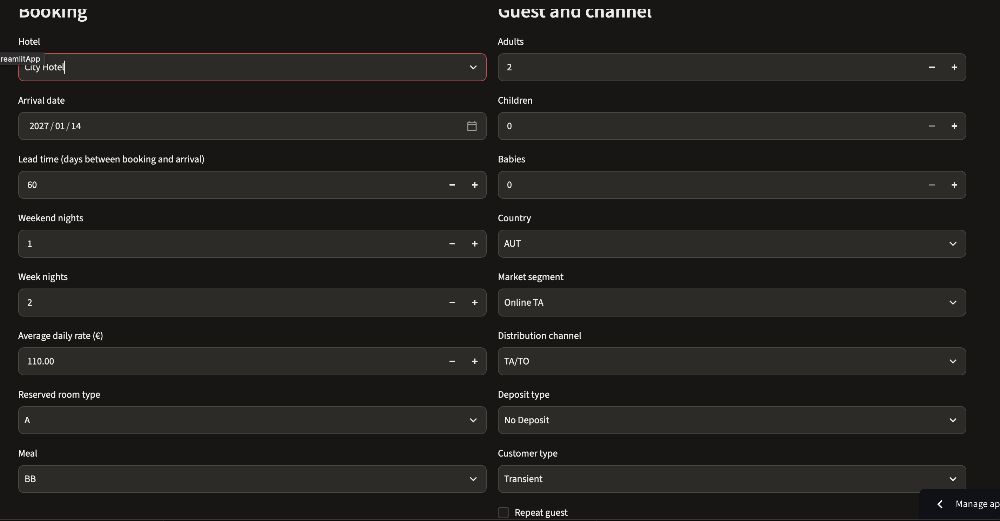
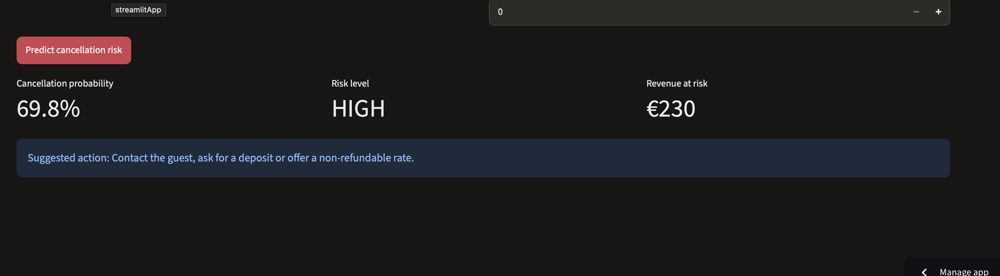
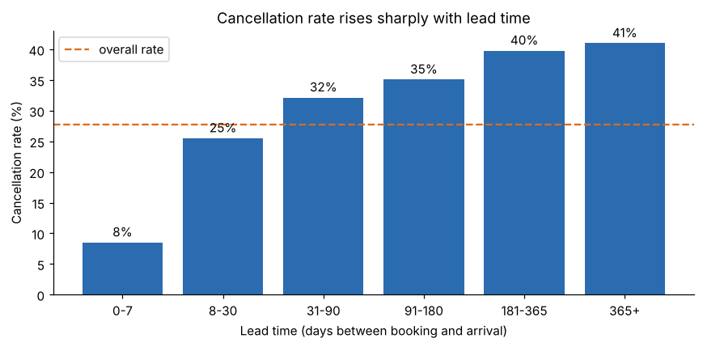
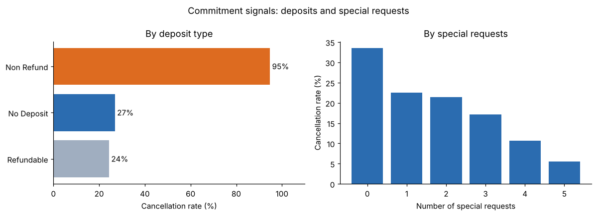
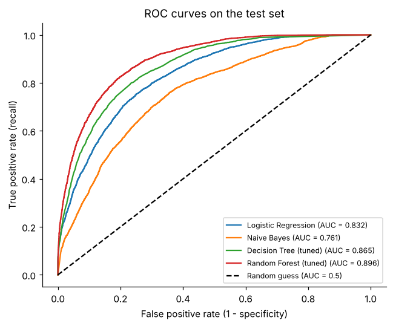
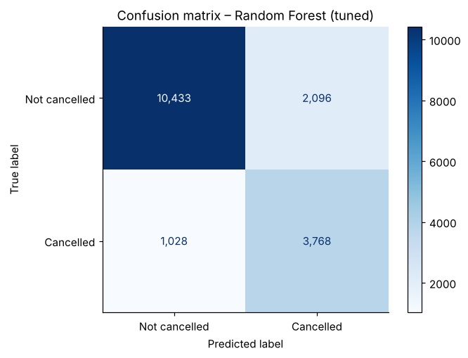
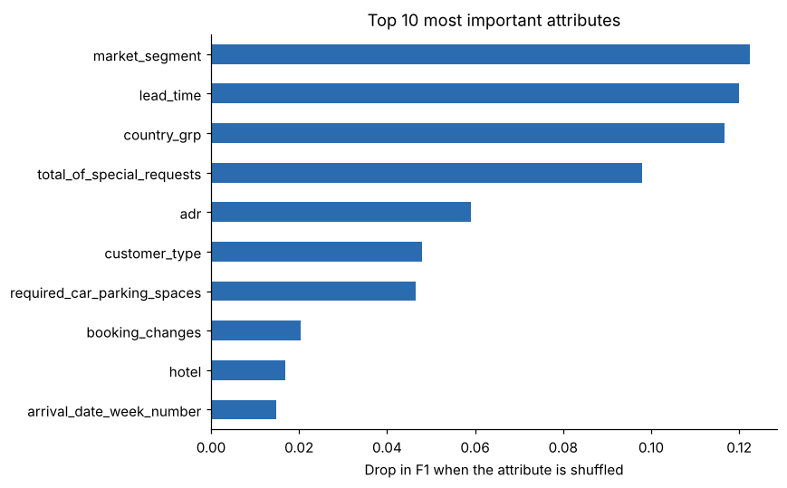
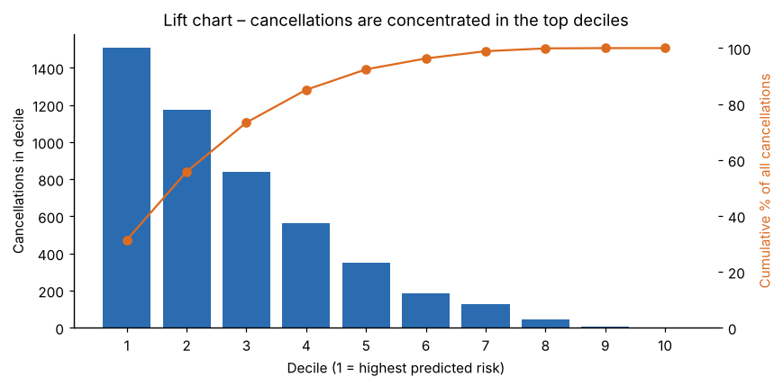

# 🏨 Hotel Booking Cancellation Prediction

**CDS 4003 – Data Science for Business Application | Group 14**

A machine learning model that predicts at booking time whether a hotel reservation will be cancelled, so staff can act before the room is lost. It's built on 119,390 bookings from a City Hotel (Lisbon) and a Resort Hotel (Algarve), 2015–2017.

**🚀 Live app:** https://hotel-cancellation-group14.streamlit.app

| Booking form | Prediction |
|---|---|
|  |  |

**📓 Notebook – Stages 1–3 (Google Colab):** https://colab.research.google.com/github/ixanm10/hotel-cancellation-prediction/blob/main/notebooks/01_stages_1-3_business_data_cleaning.ipynb

**📓 Full notebook – Stages 1–7 + extra analysis:** [view on GitHub](https://github.com/ixanm10/hotel-cancellation-prediction/blob/main/notebooks/Hotel_Cancellation_Colab.ipynb) · [open in Colab](https://colab.research.google.com/github/ixanm10/hotel-cancellation-prediction/blob/main/notebooks/Hotel_Cancellation_Colab.ipynb)


## Team

| Name | GitHub | Role |
|------|--------|------|
| Amna Nasser Alshamsi | [Ixanm10](https://github.com/ixanm10) | Model evaluation and comparison, Streamlit app, explaining results for hotel staff |
| Amna Ali Alhosani | [amna2116](https://github.com/amna2116) | Data understanding and cleaning: missing values, duplicates, inconsistent categories, outliers, data quality checks |
| Fatema Ahmed Alyileili | [FatmaAhmedAlyileili](https://github.com/FatmaAhmedAlyileili) | Business problem and objectives, dataset comparison and justification (source, licence, limitations), Python code support |

## Results (hold-out test set)

| Model | Accuracy | Precision | Recall | F1 | ROC-AUC |
|-------|----------|-----------|--------|----|---------|
| **Random Forest (tuned)** | **0.820** | **0.643** | **0.786** | **0.707** | **0.896** |
| Gradient Boosted Trees (tuned) | 0.811 | 0.619 | 0.820 | 0.706 | 0.899 |
| Decision Tree (tuned) | 0.762 | 0.546 | 0.824 | 0.657 | 0.865 |
| Logistic Regression | 0.743 | 0.525 | 0.768 | 0.623 | 0.832 |
| Naive Bayes | 0.555 | 0.371 | 0.874 | 0.521 | 0.761 |
| Baseline (majority class) | 0.723 | 0.000 | 0.000 | 0.000 | 0.500 |

Main drivers of cancellation: lead time, deposit type, country, market segment and special requests.

### Why we chose the final model

Random Forest and Gradient Boosted Trees were the best performing models after tuning, with F1 scores of 0.707 and 0.706 respectively on the test set. Random Forest is the final model implemented, mainly because it had the highest test F1 score (0.707), a test accuracy of 0.820 and a precision of 0.643 compared to 0.619 for Gradient Boosted Trees, meaning fewer false alarms. However, Gradient Boosted Trees had a lower test error cost at threshold 0.4 (€167,540 compared to Random Forest's €175,620). Gradient Boosted Trees also overfit less than Random Forest, with a gap of 0.07 in train-test F1 compared to 0.18. Thus, in future versions of the system Gradient Boosted Trees deserves further exploration.

## Key charts

| | |
|---|---|
|  |  |
|  |  |
|  |  |

All 17 figures are in [`figures/`](figures/).

## Extra analysis

At the end of the full notebook ([`notebooks/Hotel_Cancellation_Colab.ipynb`](notebooks/Hotel_Cancellation_Colab.ipynb)), six extra checks:

| Part | What it checks | Result |
|------|----------------|--------|
| A | Model choice by cross-validation (not the test set) | CV F1: Gradient Boosting 0.696, Random Forest 0.694, Decision Tree 0.648 |
| B | Overfitting (train F1 vs test F1) | Random Forest 0.883 vs 0.707 (gap 0.18); Gradient Boosting 0.774 vs 0.706 (gap 0.07) |
| C | Precision–recall curve | Shows the trade-off behind the threshold choice |
| D | Final model at threshold 0.4 | Recall 0.87, precision 0.57 |
| E | Extra EDA | Cancellation by lead time × deposit type; by customer type (Transient 30.3%, Group 9.9%) |
| F | Removed duplicates | 42% were Group bookings (17% of all bookings), so some may have been real bookings |

## Repository structure

```
├── .github/workflows/pipeline.yml   # GitHub Actions: runs the pipeline on every push
├── app/app.py                       # Streamlit app (risk score for a new booking)
├── data/hotel_bookings.csv          # raw dataset
├── docs/data_dictionary.md          # description of every column
├── docs/dataset_search.md           # datasets considered, accepted and rejected
├── figures/                         # charts from the notebook + app screenshots
├── notebooks/01_stages_1-3_business_data_cleaning.ipynb   # Stages 1–3 only
├── notebooks/Hotel_Cancellation_Colab.ipynb   # full analysis, Stages 1–7 + extra analysis, with outputs
├── reports/CDS4003_Group14_Final_Report.pdf   # group report (PDF + Word)
├── src/pipeline.py                  # clean -> features -> train -> evaluate -> save model
├── tests/test_pipeline.py           # data quality checks
└── requirements.txt
```

## The pipeline

```
data/hotel_bookings.csv
   │  1. clean (missing values, duplicates, impossible values, 'Undefined')
   │  2. build features (total_nights, prev_cancel_rate, country_grp, ...)
   │  3. split 80/20 stratified
   │  4. train 6 models (baseline, LR, NB, DT, RF, GBT) + tuning
   │  5. evaluate on test set (F1, recall, AUC, cost of errors)
   ▼  6. save best model
models/model.joblib  ──►  app/app.py (Streamlit)
```

Every push to `main` makes **GitHub Actions** run the tests, run the pipeline, check that F1 ≥ 0.68 and AUC ≥ 0.85, and upload the trained model and figures as a downloadable artifact (Actions tab → latest run → *Artifacts*).

## Run it yourself

```bash
pip install -r requirements.txt
python src/pipeline.py --quick     # fast (~20 s), no tuning
python src/pipeline.py             # full run with hyperparameter tuning
streamlit run app/app.py           # open the app
```

**Notebook in Google Colab:**
- Stages 1–3 (business problem, data collection, cleaning): [Open in Colab](https://colab.research.google.com/github/ixanm10/hotel-cancellation-prediction/blob/main/notebooks/01_stages_1-3_business_data_cleaning.ipynb) – the data loads from this repository automatically.

## Dataset

- **Name:** Hotel Booking Demand (`data/hotel_bookings.csv`), 119,390 bookings × 32 columns, July 2015 – August 2017
- **Download:** https://www.kaggle.com/datasets/jessemostipak/hotel-booking-demand (a copy is already in `data/`)
- **Original source:** Antonio, N., de Almeida, A., & Nunes, L. (2019). Hotel booking demand datasets. *Data in Brief, 22*, 41–49. https://doi.org/10.1016/j.dib.2018.11.126
- **Licence:** CC BY 4.0 – academic use allowed with attribution
- **Size:** below the 200,000-row guideline; approved by the instructor at Milestone 2
- Dataset search evidence: [`docs/dataset_search.md`](docs/dataset_search.md) · column descriptions: [`docs/data_dictionary.md`](docs/data_dictionary.md)


## Use of AI tools

Claude was used under the direction of Amna Nasser Alshamsi (ixanm10), who decided what to build or change, reviewed every result and approved all changes. Commits labelled "Claude" in the history were made at her request.
